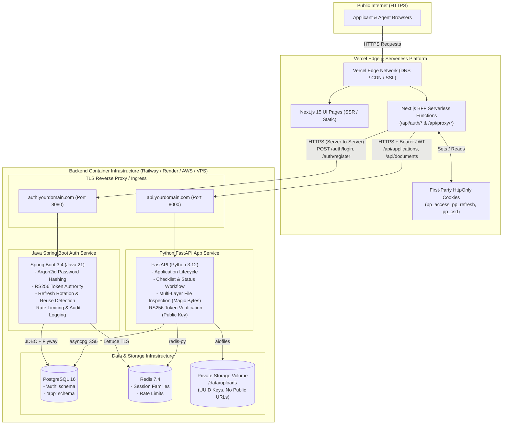

# Production Deployment Guide: Vercel + Backend Infrastructure

This document outlines the exact production deployment architecture for the **Passport Application Assistance Platform**, explaining which components run on **Vercel**, which components require **dedicated hosting**, how to configure environment variables safely, and how inter-service communication and document security operate in production.

---

## 1. Executive Summary & Component Distribution

The platform consists of three application services, two data stores, and a private file storage volume:

| Component | Technology | Can Run on Vercel? | Recommended Production Host | Reason |
| :--- | :--- | :---: | :--- | :--- |
| **Frontend & BFF** | Next.js 15 (React 19, TypeScript) | **YES (Native)** | **Vercel** | Edge CDN, SSR, and Node.js serverless functions for BFF routes (`/api/auth/*`, `/api/proxy/*`). |
| **Auth Service** | Java 21, Spring Boot 3.4.1 | **NO** | **Railway / Render / AWS ECS / VPS** | Vercel provides **zero JVM/Java runtime support**. Requires long-running container process with connection pools and scheduled tasks. |
| **App Service** | Python 3.12, FastAPI, SQLAlchemy | **NO (Not Safely)** | **Railway / Render / AWS ECS / VPS** | **4 Critical Blockers on Vercel Serverless:**<br>1. *Ephemeral Disk:* Uploaded identity documents in `/data/uploads` disappear on lambda recycle.<br>2. *4.5 MB Limit:* Vercel has a hard 4.5 MB serverless body limit (our uploads allow 5 MB).<br>3. *Missing C Libraries:* `python-magic` requires `libmagic1` system C library.<br>4. *Connection Exhaustion:* Unpooled serverless asyncpg connections overwhelm PostgreSQL. |
| **Database** | PostgreSQL 16 | **NO** | **Managed Postgres** (Supabase, Neon, AWS RDS, Railway) | Vercel is stateless compute, not a persistent relational database host. Needs `auth` and `app` schemas. |
| **Cache & Sessions** | Redis 7.4 | **NO** | **Managed Redis** (Upstash, Redis Cloud, Railway Redis) | Stateful in-memory store for session families, token rotation, and sliding-window rate limiters. |
| **Document Storage** | Private File Storage | **NO** | **Persistent Volume or S3 / Cloudflare R2** | Identity proof scans must never be publicly exposed and require persistent private storage. |

---

## 2. Production Architecture Diagram



---

## 3. Step-by-Step Vercel Configuration

### Step 3.1: Connect Repository & Set Root Directory
In the Vercel Dashboard when importing your Git repository:
1. **Project Name:** `passport-platform-frontend` (or your choice).
2. **Framework Preset:** `Next.js`.
3. **Root Directory:** Click **Edit** and select **`frontend`**.
   *(CRITICAL: Do NOT leave Root Directory as `./`. Setting it to `frontend` ensures Vercel ignores the Python and Java directories and builds only the Next.js application).*
4. **Build Command:** Leave as default (`next build`).
5. **Output Directory:** Leave as default (`.next`).
6. **Install Command:** Leave as default (`npm install`).

### Step 3.2: Configure Vercel Environment Variables
Add these in **Vercel Project Settings → Environment Variables**:

| Variable Name | Example Production Value | Sensitivity | Explanation |
| :--- | :--- | :---: | :--- |
| `INTERNAL_AUTH_SERVICE_URL` | `https://auth.yourdomain.com` | Protected | Public HTTPS URL where your Java Auth Service is hosted. Read server-side by BFF. |
| `INTERNAL_APP_SERVICE_URL` | `https://api.yourdomain.com` | Protected | Public HTTPS URL where your FastAPI App Service is hosted. Read server-side by BFF proxy. |
| `NEXT_PUBLIC_APP_URL` | `https://passport.yourdomain.com` | Public | The public URL of your Vercel deployment (or custom domain). |
| `COOKIE_SECURE` | `true` | Protected | Enforces `Secure` attribute on all HttpOnly cookies over HTTPS. |
| `COOKIE_SAME_SITE` | `Strict` | Protected | Strict SameSite policy preventing cross-site cookie leaks. |
| `NODE_ENV` | `production` | Protected | Optimizes React and Next.js runtime. |

---

## 4. Backend Hosting Configuration (Java, Python, Postgres, Redis)

Choose one of the following two deployment methods for your backend components:

### Option A: Railway / Render / DigitalOcean (Recommended PaaS)

1. **PostgreSQL Database:**
   - Create a PostgreSQL 16 database.
   - Run the initialization SQL script: [`database/init/01_init.sql`](file:///C:/Users/Arman/.gemini/antigravity/scratch/passport-platform/database/init/01_init.sql) to create `auth` and `app` schemas.
   - Note down `DATABASE_URL` (with SSL mode enabled: `sslmode=require`).

2. **Redis Instance:**
   - Create a Redis 7.4 instance with persistent storage (AOF enabled) and password authentication.
   - Note down host, port, and password.

3. **Java Auth Service (`auth-service/`):**
   - Deploy as a Docker service using `auth-service/Dockerfile`.
   - Set Environment Variables:
     ```env
     SPRING_PROFILES_ACTIVE=prod
     SPRING_DATASOURCE_URL=jdbc:postgresql://<pg_host>:<pg_port>/<db_name>?sslmode=require
     SPRING_DATASOURCE_USERNAME=<db_user>
     SPRING_DATASOURCE_PASSWORD=<db_password>
     SPRING_DATA_REDIS_HOST=<redis_host>
     SPRING_DATA_REDIS_PORT=<redis_port>
     SPRING_DATA_REDIS_PASSWORD=<redis_password>
     SPRING_DATA_REDIS_SSL_ENABLED=true
     JWT_PRIVATE_KEY_BASE64=<base64_rsa_private_key>
     JWT_PUBLIC_KEY_BASE64=<base64_rsa_public_key>
     JWT_ISSUER=https://passport.yourdomain.com
     JWT_AUDIENCE=passport-platform-api
     JWT_ACCESS_TOKEN_EXPIRY_MINUTES=15
     JWT_REFRESH_TOKEN_EXPIRY_DAYS=7
     JWT_MAX_SESSION_DAYS=30
     RATE_LIMIT_LOGIN_MAX_ATTEMPTS=10
     RATE_LIMIT_LOGIN_WINDOW_MINUTES=15
     INTERNAL_API_SECRET=<random_32_char_hex_secret>
     FRONTEND_ORIGIN=https://passport.yourdomain.com
     SERVER_PORT=8080
     ```
   - Expose public domain: `https://auth.yourdomain.com`.

4. **Python App Service (`app-service/`):**
   - Deploy as a Docker service using `app-service/Dockerfile`.
   - Attach a **Persistent Storage Disk / Volume** mounted to `/data/uploads`.
   - Set Environment Variables:
     ```env
     ENVIRONMENT=production
     DATABASE_URL=postgresql+asyncpg://<db_user>:<db_password>@<pg_host>:<pg_port>/<db_name>?ssl=require
     DATABASE_URL_SYNC=postgresql://<db_user>:<db_password>@<pg_host>:<pg_port>/<db_name>?sslmode=require
     REDIS_URL=rediss://:<redis_password>@<redis_host>:<redis_port>/0
     JWT_PUBLIC_KEY_BASE64=<base64_rsa_public_key>
     JWT_ISSUER=https://passport.yourdomain.com
     JWT_AUDIENCE=passport-platform-api
     UPLOAD_DIR=/data/uploads
     MAX_FILE_SIZE_BYTES=5242880
     ALLOWED_EXTENSIONS=pdf,jpg,jpeg,png
     ALLOWED_MIME_TYPES=application/pdf,image/jpeg,image/png
     APP_PORT=8000
     ```
   - Expose public domain: `https://api.yourdomain.com`.

---

### Option B: Single Cloud VPS (AWS EC2 / DigitalOcean Droplet / Hetzner)

You can run the entire backend container suite on a single Linux host using the existing `docker-compose.yml`:
1. Clone repo onto the server.
2. Generate production `.env` with strong random passwords and RSA keys.
3. Use an Nginx or Caddy reverse proxy to manage SSL termination (Let's Encrypt):
   - Proxy `https://auth.yourdomain.com` → `http://127.0.0.1:8080`
   - Proxy `https://api.yourdomain.com` → `http://127.0.0.1:8000`
4. PostgreSQL (`127.0.0.1:5433`), Redis (`127.0.0.1:6379`), and `/data/uploads` stay completely private and unexposed.

---

## 5. Security & Cryptographic Key Management

### RSA-4096 Key Pair Generation
Generate a fresh asymmetric key pair for production:
```bash
# 1. Generate private key
openssl genrsa -out auth_private.pem 4096

# 2. Extract public key in PKCS#8 format
openssl rsa -in auth_private.pem -pubout -out auth_public.pem

# 3. Base64-encode as single-line strings (no line breaks)
# On Linux / macOS:
base64 -w 0 auth_private.pem > private_b64.txt
base64 -w 0 auth_public.pem > public_b64.txt

# On Windows (PowerShell):
[Convert]::ToBase64String([IO.File]::ReadAllBytes("auth_private.pem")) | Out-File -NoNewline private_b64.txt
[Convert]::ToBase64String([IO.File]::ReadAllBytes("auth_public.pem"))  | Out-File -NoNewline public_b64.txt
```
- Set `JWT_PRIVATE_KEY_BASE64` **ONLY** on the Java Auth Service.
- Set `JWT_PUBLIC_KEY_BASE64` on **BOTH** the Java Auth Service and Python App Service.
- **Never commit `.pem` or base64 key files to Git.**

---

## 6. End-to-End Verification Runbook for Production

After deploying Vercel and the backend services:

1. **Verify Health Endpoints:**
   ```bash
   curl -I https://passport.yourdomain.com/
   curl https://auth.yourdomain.com/actuator/health
   curl https://api.yourdomain.com/health
   ```
2. **Verify Mandatory Disclaimer:**
   Confirm `https://passport.yourdomain.com/` displays:
   > *"This platform is NOT an official government passport issuance system. It is not affiliated with the Government of India or Passport Seva."*
3. **Verify Customer Registration & Cookie Flags:**
   - Register a customer via `https://passport.yourdomain.com/auth/register`.
   - Inspect browser cookies in DevTools:
     - `pp_access`: `HttpOnly: true`, `Secure: true`, `SameSite: Strict`.
     - `pp_refresh`: `HttpOnly: true`, `Secure: true`, `SameSite: Strict`.
     - `pp_csrf`: `HttpOnly: false`, `Secure: true`, `SameSite: Strict`.
4. **Verify Document Upload & Review:**
   - Initiate a passport application in the customer dashboard.
   - Upload a genuine PDF (e.g. Aadhaar card proof).
   - Log into the agent portal (`https://passport.yourdomain.com/agent`).
   - Confirm the submitted document appears, review and mark **APPROVED**.
   - Verify customer dashboard updates real-time status to **UNDER_REVIEW**.
